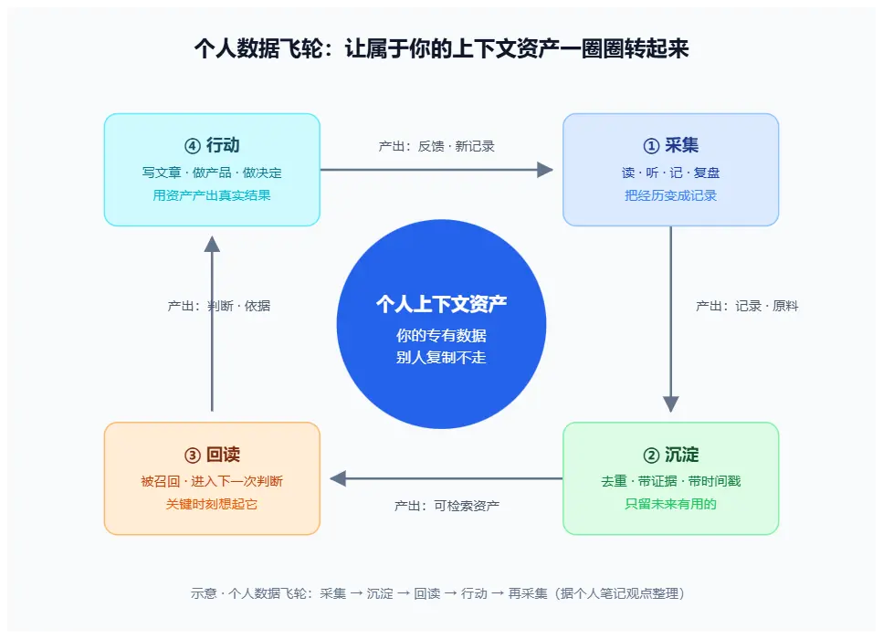

> 模型能力是公共的、会快速升值的；你的上下文是私有的、只会过期的。当所有人握着同一个模型时，真正的分水岭，是你喂给它的、也只属于你的那堆记录。

---

## 引言：同一个模型，为什么产出差距越来越大

有一个现象值得停下来想：现在几乎所有人都能打开同一个大模型，花同样的几块钱，问同样的问题。可为什么有的人拿它写出深度文章、做出能用的产品、攒下越来越值钱的判断，而另一些人只得到一段段差不多的通用回答？

差距不在模型。模型对每个人是一样的，甚至每天都在变强，越来越便宜。

差距在别处——**在你自己的上下文资产**。

这是一个很容易被忽略的结论。因为我们长期被训练成"模型能力决定一切"：模型不行，所以效果不好；等模型变强，一切都会好。但真等模型变强之后，你会发现自己和一个比你积累更多的人，差距反而拉得更大了。因为公共的部分大家都一样，私有部分才会显形。

## 一、模型能力正在快速商品化

先看一个基本事实：软件再生产的成本，被压到了一个晚上。

以前抄一个产品，要一个团队花几个月把功能和界面重做一遍，"我们先做出来"能挡一阵。现在给定一个说得清的产品，一个 cloud agent 可以一夜之间把代码、功能和界面再做一版。实现上的领先还在，但能撑住的时间被压短了。

被压短的是比特的再生产：说得清的界面、写得出来的功能、能放进提示词的流程，都在跟着变便宜。这是 Nikita Bier 那条著名帖子的起点——技术护城河差不多结束了，要做长久的东西，只剩三样：**专有数据、网络效应，和一块实体部分**。

放在这个框架里看，你手里的"上下文"属于哪一类？

它属于专有数据。而且是唯一一类**你天然拥有、别人天然爬不到**的专有数据。

## 二、什么没有被商品化：你的上下文

专有数据防的是"别人没有这份原料"。

模型擅长从公开材料里再生实现。看得到的界面、说得清的流程、写得出来的代码，都可以被再做一遍。但它生成不了从未离开过你系统的东西：你读过的几十本书，你看完做过的笔记，你踩过又爬出来的坑，你一次次改掉的判断，你在一件具体的事上反复失败才换来的那点分寸。

这些不在网页上，也不在训练集里。提示词补不出一份别人没公开过的历史。

这就是为什么"做出来"变便宜之后，这类资产反而更值钱。耐久的从来不是功能清单，而是别人买不到、也爬不到的记录。

对个人来说，这层更值得在意。砸钱买来的数据和网络通常够不着——那是大厂的游戏。而**你自己的上下文资产是免费获得的、每天自动增长的、且复制不走的**。它就是你读过的、想过的、做过的、踩过的、改过的那些判断本身。

## 三、但"拥有"不是防御，数据要转起来

到这里有个陷阱要绕开：**光攒数据，不等于护城河。**

Factory AI 的 CTO Eno Reyes 把这一点说得很刻薄：四大会计所握着所有客户和流程数据，按"有专有数据就能守住"的逻辑，不该被后起的公司拿走一块市场——但 Ramp 还是拿走了。GitHub 的开发网络极强，这一轮 AI 编程的赢家却不是它。

反例否定的是"拥有即防御"。握着专有数据，不会自动变成胜势。

原因很朴素：**数据是原料，原料要进入下一次判断，才开始挡人。** 停在仓库里的记录，只是文件。你囤了一千条笔记却从不回读，那它们和没写没有区别。判断、决策、产出没有用上它，它就没有产生任何排他性。

所以真正的问题是：**怎么让你的上下文资产"转起来"？**

## 四、个人数据飞轮：采集 → 沉淀 → 回读 → 行动 → 再采集



一个资产要变成护城河，它得是一个**环**，不是一个仓库。

个人数据飞轮大致是这样一个闭环：

```
采集（读文章、看视频、记想法、记录决策与反馈）
   ↓
沉淀（去重、带来源证据、带时间戳、结构化）
   ↓
回读（在需要时被检索/召回，进入下一次判断）
   ↓
行动（用沉淀产出：写文章、做产品、做决定）
   ↓
行动产生新记录（结果、反馈、踩坑）── 回到采集
```

每一圈，资产都在变厚，而且每一圈都只属于你一个人。

这四个环节各有各的坑：

**采集**——主动摄入，别等。读、听、记、复盘，都是采集。关键是把"经历"转成"记录"。一次成功的项目、一次翻车、一个被推翻的判断，都是最高价值的原料。

**沉淀**——这是最容易被跳过、也最决定成败的一环。沉淀不是把聊天记录全存进向量库，而是做**记忆治理**：只保留"未来有用、具有依据、允许持久化"的内容。带来源、带时间、带条件。垃圾进，垃圾出；不加治理的囤积，只会让召回变脏。

**回读**——让资产在你做判断的那一刻被想起。这依赖检索层、引用机制、以及"知道什么时候该用它"的触发逻辑。攒了不会用，等于没攒。

**行动**——用资产产出真实的东西。写一篇博客、做一个产品、做一个决定。行动是飞轮的发动机，也是检验资产有没有用的试金石。

然后，行动产生的反馈（读者卡在哪、哪个决策对了、哪个错了）又成为下一圈的采集输入。环只要在转，就会复利；环停了，资产就会过期、信任就会变薄。

## 五、怎么把飞轮转起来：一份可落地的清单

说清楚道理，落到能执行的程度。我基于自己在做的知识闭环，给一份参考清单：

1. **搭一条"摄入 → 编译 → 落盘 → 回读"的链路**，而不是零散地记。看到一篇好文章、一个视频，不只是收藏，而是走完"接收 → 理解 → 编译成笔记 → 落盘进知识库"全过程，让每条记录都进得了、出得来。

2. **分清四样东西，别混**：

   - Prompt（指令）——怎么写任务；
   - Context（本轮输入）——本轮该看什么；
   - State（进度）——任务做到哪一步；
   - Memory（跨会话资产）——哪些值得长期保留。
     很多人把 Memory 当成"聊天记录全存进向量库"，这是最大的误解。记忆是"跨会话保存、审核、召回、更新与遗忘"的受控资产，不是整段对话的复制。

3. **给记忆做生命周期治理**：写入 → 审核 → 激活 → 召回 → 更新 → 遗忘。一条信息能不能进，问三个问题：未来还有用吗？有依据吗？允许持久化吗？三个都答"是"，才存。一次偶然成功不自动变成"通用方法"；多次转述同一件事，不等于它变成了你的稳定偏好。

4. **用"复用性"判断要不要沉淀**：同一个问题反复出现、同一个错误反复踩，才值得提炼成一条稳定偏好或 SOP。临时的一次性要求，用完就丢，别污染长期资产。

## 六、模型越强，越要加厚"承载层"

关于个人数据飞轮，还有一个常被忽略的观察：**模型越强，你的上下文资产越值钱**。

Personal Agent 的拆解里有个很核心的区分——**补偿层 vs 承载层**：

- **补偿层**：因为今天的模型还不够好，才替它做的事（冗长规则、专用工具、意图路由、手写检索）。这些会随着模型变强先升值、后贬值，最后变成负担，要随时准备删。
- **承载层**：不管模型多强都需要的东西（数据、记忆、权限、集成、评测、上下文）。这些长期沉淀、持续增值，要每天加厚。

你的个人上下文资产，就是最典型的**承载层**。

检验标准很直接：同一模型家族里，把弱模型换成强模型，你的架构能拿到多少提升？差值越大，说明你的承载层越厚、越能跟着模型一起变好；差值越小，说明你在靠补偿层撑着，模型一换代就露馅。

一个靠提示词堆出来的"假懂"，和一个靠真实记录攒出来的"真懂"，在弱模型时代可能看起来差不多。但换一个强模型，前者立刻被冲掉，后者原地升值。**你积累的上下文，是少数几个"下一代模型也冲不掉"的东西。**

## 结论：护城河是每天在挖的动作

模型会一代一代变强，价格会越来越低，通用能力会越来越商品化。这场变化的终点，是稀缺从"能不能做出来"挪到了"你积累了什么、谁愿意留下来"。

对个人而言，够得着、而且会复利的那条路，不是追逐下一个模型，而是认认真真对待自己读的、想的、做的、踩的那些坑——把它们变成能回读、能复用、能产生新判断的资产，让它在每一次决策里进入、转起来。

Nikita 那句话说得好：**护城河是每天在挖的动作。** 对个人来说，这个动作不是别的，就是——持续采集、认真沉淀、经常回读、勇敢行动，让属于你自己的数据飞轮，一圈一圈转起来。

---

_本文观点基于我自己的 Agent 应用学习笔记整理；飞轮框架是对"专有数据 + 记忆治理 + 承载层"三个概念的合成，具体落地请结合你自己的工具与场景。_
