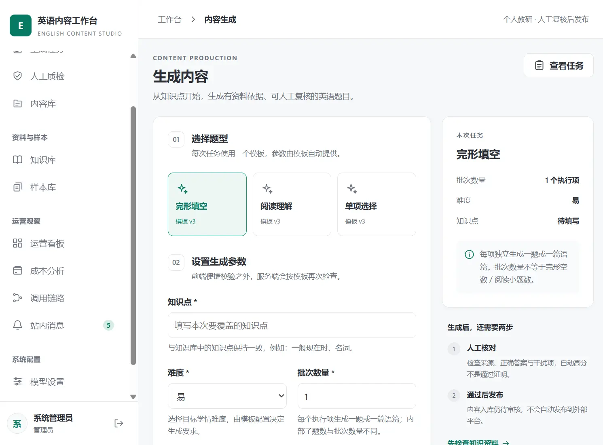
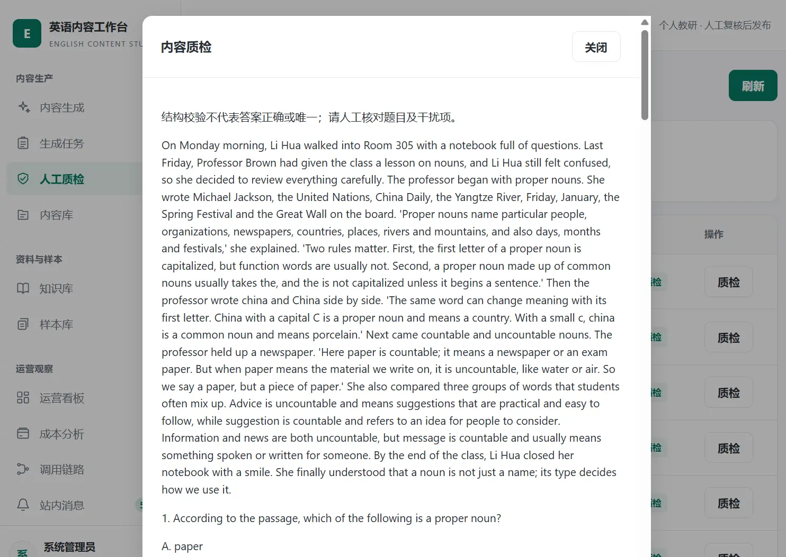
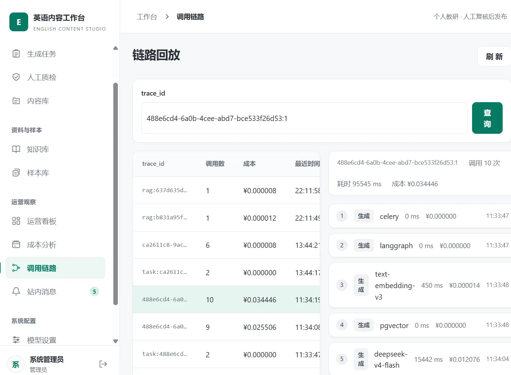

## 它能完整办成的一件事

把一份英语教材丢进去，出来一批题：单选、完形、阅读。每道题带着答案、解析，和一个能点回原文的片段——那一页、那一块。规则先拒掉能确定的错，模型再判语感、干扰项质量、解析够不够，人看最后一眼，通过的那批存成样本。

它要回答的不是「能不能生成」，而是「生成之后，谁凭什么信它对」。

_图 1：一次批量生成。参数、题型和数量在上，结果是带答案与解析的成稿，下方保留这次生成的知识来源。点击图片可以放大。_

<iframe src="/diagrams/english-pipeline.html" title="英语内容生产工作台七阶段流水线与恢复边界（可交互）" loading="lazy" style="width:100%;height:640px;border:1px solid #8884;border-radius:8px;"></iframe>

_图 2：七阶段流水线与恢复边界（交互版）。悬停节点与连线可单独聚焦那一步，右上角可切换深浅主题；下面那条虚线带画的是请求落 Outbox 之后的投递、租约与周期对账。[在新窗口打开](/diagrams/english-pipeline.html)可放大阅读。_

## 我为什么把它做成这样

**规则先于模型。** 选项重复、答案字母越界、完形空格数和 blanks 对不上，这些代码能直接拒绝，不该花 token 去问模型。模型只判它真正擅长的部分。两层都不覆盖的，交给人。

**来源必需，宁可失败。** 内置三种题型都把检索设成必填：取不到符合条件的知识片段，就在调用生成模型之前失败。代价是知识点标签没建好的题目出不来——这个代价我接受，因为一条没有出处的题，复核的人无从判断。

**不追求全自动。** 生成器写得再好，也换不来一句「这批可以直接发」。人工复核那一步不省，省掉的是翻找原文和初筛的时间。

## 三段实现

- [规则、模型、人：三层判定各管什么](/projects/english-content-workbench/quality-loop)：能写成判断的交给代码，语感和干扰项交给模型，最后一眼留给人，分数只当筛选器。
- [从一份教材到一道能引用原文的题](/projects/english-content-workbench/rag)：解析、结构切分、索引、融合排序，以及为什么取到原文只是起点。
- [一次生成要跨五个地方保持一致](/projects/english-content-workbench/reliability)：任务、条目、内容五种状态，重试、幂等和补偿各挡住什么。

## 做到什么程度

链路是完整的七段：资料接入 → 知识检索 → 内容生成 → 自动质检 → 人工复核 → 样本沉淀 → 成本与链路分析。前四段是机器，中间一段是人，最后两段留证据；每次调用留一条 Trace，能回放这稿是怎么出来的。

工程侧：1154 个测试通过（1091 个非集成 + 63 个连真实 PostgreSQL），应用层覆盖率 8974/10677 即 84.05%，门槛设在 80%。连真实库的用例在夹具里跑迁移，不是 mock 表结构。

内容侧：6 条真实题目跑完自动质检，得分 87.70～91.75，全部进待人工复核队列——自动分只负责排序和取舍，定稿仍然归人。三份资料建成 81 个 leaf 向量，44 条来源回归在 Top5 和 Top8 上都是 44/44 齐备。

_图 3：自动质检之后的复核台。题目、选项、答案、解析和知识来源放在同一屏，自动分只当筛选器，定稿由人点。点击图片可以放大。_

_图 4：按 trace_id 回放一稿。每次生成与质检调用都绑同一条链路标识，失败重试也记在链路上，所以「这稿怎么出来的」能逐段查。点击图片可以放大。_

## 适用范围

面向教研组内部的批量出题，单人维护、本机部署。出版级校对、多学科扩展、多人协同审校不在这一版范围内。
