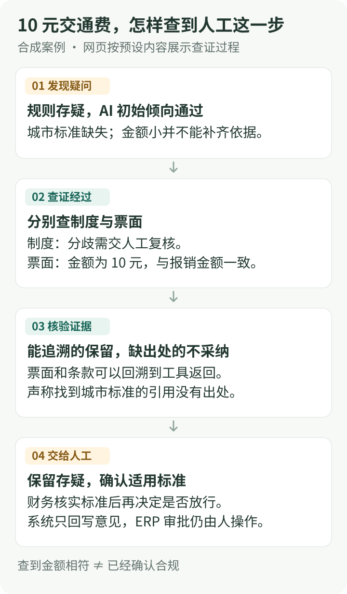

## 10 元交通费，为什么还要查证

DEMO-0003 的员工在“样例市”报销 10 元市内交通费。规则找不到适用城市标准，给出存疑；AI 的初始意见因为金额小而倾向通过。两者意见不同，于是进入查证。

下面把 Demo 里的预设案例展开。它展示原 POC 的分工原则，图中的调用和证据由合成样例提供，浏览器不会实际调用模型或工具。

_图 1：票面金额与报销金额一致，只回答了“金额是否相符”；适用标准仍然缺失，因此不能据此确认合规。_

[打开 Demo](/projects/finance-review-agent/demo/)，点击“看案例：10 元交通费”，可以操作这四步。

## 四个角色，各自回答一个问题

| 角色             | 回答什么                     | 输出与边界                                       |
| ---------------- | ---------------------------- | ------------------------------------------------ |
| OCR              | 票面写了什么？               | 金额、抬头、税号、票号、日期；识别失败就保留缺口 |
| 规则             | 哪些字段符合或违反明确标准？ | 审核建议、违规码、理由；标准缺失时交人工关注     |
| 模型与调查 Agent | 还有什么疑点，需要查什么？   | 第二意见、调查摘要与来源；通过只读工具查证       |
| 财务人员         | 依据是否适用，材料是否充分？ | 记录复核决定；在 ERP 中操作最终审批              |

差旅规则覆盖住宿、伙食、市内交通、长途舱位、抬头、税号、金额、重复发票、加班打车审批、缺附件和科目归集，共 11 类检查。每张单据都经过同一套规则，票面可用时优先采用相应票面字段。

OCR 取回的是证据字段，规则再做比较。附件缺失、识别失败或城市不在标准表，都应保留待核实项，不能凭文字说明补造票据。

## 第二意见怎样进入最终建议

模型独立复核后，系统比较它与规则的意见。意见一致时保留原建议；存在分歧时转存疑（FLAG），由人核实。模型调用失败时回退到规则意见。

原 POC 的图模式还包含调查后的裁决节点。调查提出“建议通过”或“建议驳回”时，裁决节点把需要关注的单据保留为 FLAG；调查结论为维持规则意见时，保留调查前已经形成的建议；分歧单仍维持 FLAG。这样，模型可以提出新线索，ERP 的审批操作仍由人完成。

在 10 元交通费案例里，查证后的新增信息是：

- 制度检索返回了“分歧交人工复核”的条款。
- 票面字段确认金额为 10 元，与报销金额相符。
- “样例市”的适用交通费标准仍未取得。

最后一项决定了人工接手的任务：确认适用标准，再决定是否放行。另一个预设案例“36 元打车缺票”则把人工任务明确为补充可核实材料。

## 引用怎么才能留下来

原 POC 用来源校验（grounding）检查调查证据。每条证据携带工具调用编号（call_id）、来源编号（source_id）和字段路径（field_path），系统检查它能否回溯到那次成功调用的返回数据。

Demo 特意保留了一条错误引用：声称找到了城市标准，但返回数据里并没有这条来源。界面将它标记为不采纳；它不能用于补齐缺失的标准。

来源和字段绑定加启发式回溯，可以拦住一部分无出处的引用。**“能追到来源”和“条款适用于这张单”仍是两项检查，后者需要业务判断。**

## 人工介入与调查预算

调查是原 POC 的可选增强路径。需要开启图模式（M2_PIPELINE=graph）和调查开关（AGENT_INVESTIGATION_ENABLED=1）；默认运行并非每单都经过 Agent。

调查只注册五个只读工具，分别读取差旅标准、制度条款、审批记录、已有 OCR 字段和发票使用台账。工具注册表没有 ERP 审批状态变更接口。

调查默认最多 5 步、14 次工具调用、30,000 tokens、90 秒墙钟时间，并限制工具超时和输出大小。失败或预算耗尽时生成降级报告，交人工关注。

如果同时开启人工 gate（AGENT_HUMAN_GATE=1），流程会暂停并保存恢复点（checkpoint）。人工提交决定时带版本号（expectedRevision），版本冲突返回 409，避免两次决定覆盖彼此。恢复后回写审核意见和人工备注，ERP 最终审批状态由人操作。

具体实现可对照[公开 Agent 工作流说明](https://github.com/b00ml/AI-financialAgent-POC/blob/main/docs/agent-workflow.md)。任务恢复与验证范围见[审核结果如何留痕与验证](/projects/finance-review-agent/engineering)。
