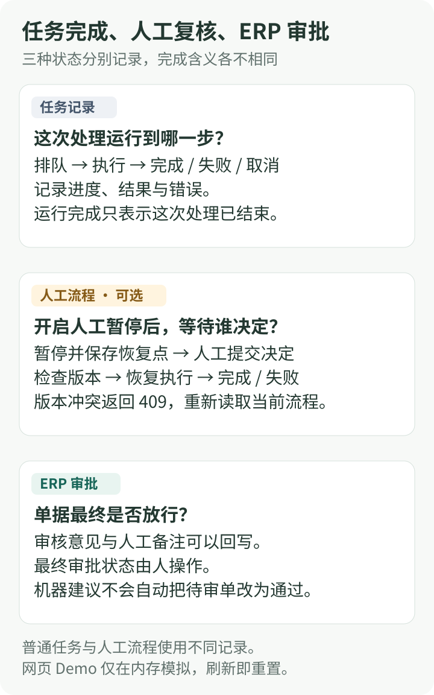

## 先分清三种状态

“任务跑完了”“人已经复核了”“ERP 审批通过了”分别回答三个问题。界面和存储都需要把它们分开，否则一个绿色的完成标记就可能让人误读业务进度。

_图 1：原 POC 的状态职责示意。人工 gate 是显式开启的路径，普通任务与 workflow 使用不同记录；回写审核意见不会替代 ERP 审批。_

网页 Demo 只在内存里模拟建议和人工记录，刷新即重置。下文的 SQLite、结果文件、版本控制和恢复点属于原 POC 后端。

## 结果保存在什么地方

财务要回看“当时查到了什么”，需要保留对应结果。POC 按用途存放运行数据：

| 数据             | 位置                                     | 用途                             |
| ---------------- | ---------------------------------------- | -------------------------------- |
| 任务记录         | `output/runtime/jobs.db`                 | 进度、结果、错误与取消           |
| M2 审核状态      | `output/cache/m2_audit_status.json`      | 单据建议、AI 结果和回写标记      |
| 人工流程记录     | `output/runtime/workflow_runs.db`        | 单据与运行的映射、人工状态和版本 |
| 流程恢复点       | `output/runtime/workflow_checkpoints.db` | 图模式暂停前后的状态             |
| M3 / M4 结果文件 | `output/artifacts/{type}/{job}/rN.json`  | 按版本保留扫描、对账结果         |
| 报告与 OCR 缓存  | `output/reports/`、`output/cache/`       | 调查报告、失败清单与票面字段复用 |

M2 的 JSON 状态使用文件锁，并以临时文件、fsync 和原子替换保护写入。M3 / M4 的结果文件带结果编号、版本、schema 版本、创建时间和 SHA-256；新的 revision 保留旧的结果文件。

这些机制分别服务于写入完整性、流程恢复和结果回看。M2 当前状态文件与 M3 / M4 版本化结果的保留方式不同，不能把它们统称为完整的历史审计库。运行目录 output 不当源码提交。

## 长任务如何执行，失败后怎么办

M2 批量审核、M3 AI 复核和 AI 全量巡检通过单节点 SQLite 任务队列执行。请求先返回 jobId，worker 领取任务并逐阶段更新进度，前端轮询查看。取消是协作式的，外部调用结束后才在安全边界停止。

普通任务在服务重启后会标记失败，需要重新提交。开启人工 gate 的图流程则单独保存恢复点（checkpoint），人工决定携带版本号 expectedRevision；版本不一致返回 409，需要重新读取当前流程，避免重复提交覆盖。

M3 规则扫描与 M4 对账由 Service 直接调用核心处理器并保存结果文件。它们与 AI 长任务的执行路径不同。SQLite 便于单节点部署与检查，当前没有分布式接管和自动重试机制。

## 缓存和检索怎样降级

OCR 按引擎复用成功结果；解析失败保留失败信息和统计，单张票的失败不会让整批审核退出。

制度检索默认使用关键词。显式选择 hybrid 后，本地 bge-small-zh-v1.5 向量召回与关键词召回通过 RRF 融合；向量模型不可用时回退到关键词。模型复核和调查同样保留失败出口，具体分工见[机器判得清，人才敢放行](/projects/finance-review-agent/boundaries)。

## 数字要和样本、来源一起读

下面整理项目已有记录。本次文章更新没有重新执行这些业务评测，各项结果来自不同样本与运行条件。

### 有公开代码入口的回归与评测

| 已记录结果                                      | 样本与口径                               | 入口与限制                                                                                                                                |
| ----------------------------------------------- | ---------------------------------------- | ----------------------------------------------------------------------------------------------------------------------------------------- |
| 公开 30 单：驳回判定 F1 = 1.0、违规一致率 = 1.0 | 公开样例标签上的回归结果                 | [评测器](https://github.com/b00ml/AI-financialAgent-POC/blob/main/core/evaluator.py)；完整运行需 ERP，不能估计未知单据准确率              |
| 困难集：结论准确率与违规集一致率均为 1.0000     | 32 条离线合成边界、复合场景              | [困难集入口](https://github.com/b00ml/AI-financialAgent-POC/blob/main/tools/eval_hard_set.py)；衡量这组固定回归用例                       |
| 注入与结构约束：9/9 通过                        | 6 条规则样例与 3 条契约、编排检查        | [评测脚本](https://github.com/b00ml/AI-financialAgent-POC/blob/main/tools/eval_injection.py)；包含离线结构保证，不是 9 次真实模型攻击测试 |
| 检索 Recall@8：keyword 0.78，hybrid 1.00        | 50 条检索标注集，考察前 8 条能否召回目标 | [检索评测](https://github.com/b00ml/AI-financialAgent-POC/blob/main/tools/eval_retrieval.py)；召回命中不等于最终审核正确                  |

公开脚本提供复跑入口，结果仍需要相应数据、配置与环境。检索延迟受 CPU、首次模型加载和缓存影响；项目没有将一次测量作为固定 SLA。

### 历史批处理资料与单次观察

| 历史记录                                                                   | 怎样理解                                                                                  |
| -------------------------------------------------------------------------- | ----------------------------------------------------------------------------------------- |
| 23,461 张虚拟发票台账，42 组重复、135 项票面问题                           | 是扫描发现的疑点数量；组数、问题项数、发票张数不能互换，也没有直接给出准确率              |
| 315 笔流水中匹配 201 笔，笔数匹配率 63.8%                                  | 是历史批处理资料的口径，需要结合当时纳入匹配的流水范围阅读；它与 Demo 的 50% 属于不同样本 |
| BX-005693 调查：2 步、8 次调用、14,602 tokens；6 条证据中 4 条通过来源回溯 | 是一次实际模型调用的冒烟记录，说明当时链路可运行；不能作为每单平均成本或来源校验成功率    |

这组历史数值沿用项目资料，完整批处理输入和逐条核对记录不在网页 Demo 中，不能通过演示复现。历史资料中的“30 单 2 到 3 分钟”也只描述批量初审观察值，不含人工终审。

## 怎么把变更纳入验证

原 POC 的验证覆盖规则单测、API 契约、工具与来源校验、workflow、任务、结果文件和对账；另有困难集、检索评测、注入与 Prompt 回归。CI 运行 Ruff、pytest、前端构建与离线门禁，具体命令见[公开评测说明](https://github.com/b00ml/AI-financialAgent-POC/blob/main/docs/evaluation.md)。

模型输出还要经过枚举、字段与违规码约束，才能进入审核报告。这些工程检查帮助发现规则和接口退化；对制度适用性的业务判断、数据质量与真实使用效果，仍需另外验收。

回到[项目总览](/projects/finance-review-agent)，可以先操作虚拟 Demo；[三条链路，三种难度](/projects/finance-review-agent/workflows)则对应每类结果该交给人处理的事项。
