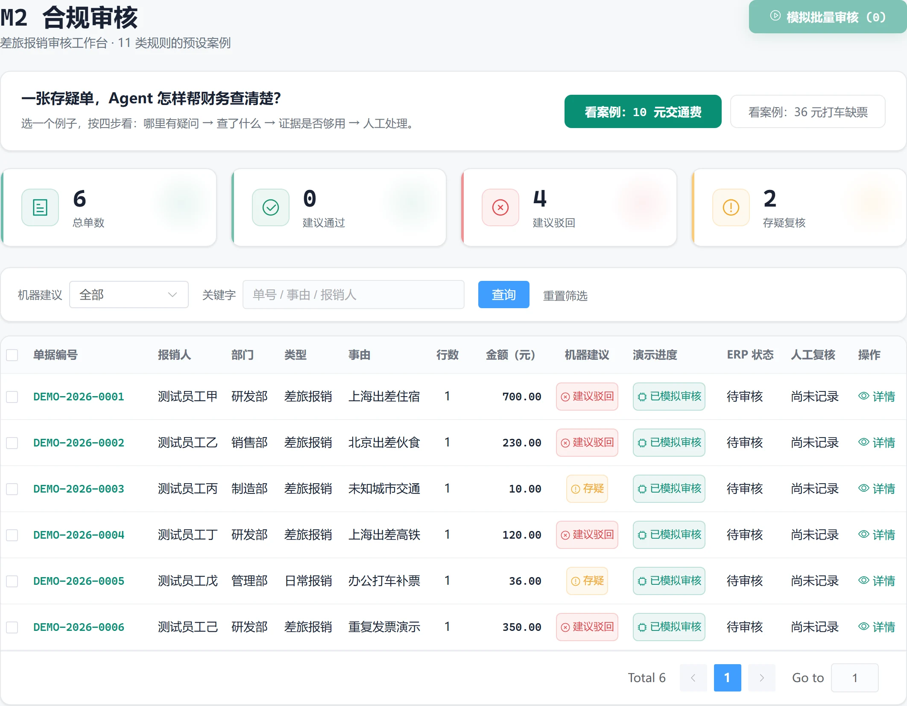

## 财务拿到的，是可以继续核实的审核意见

一张报销单里，住宿有没有超标、发票有没有重复、缺票应该补什么，往往要在单据、附件、制度和历史台账之间来回找。这个 POC 把这些核对动作串起来，给财务人员一份带疑点和依据的审核意见。

它覆盖三个入口：报销审核（M2）、发票稽核（M3）和银行对账（M4）。我的产品设计重点是拆清每条链路的输入与输出、定义证据不足时谁来接手，以及让机器建议和人工决定在界面上各有位置。

_图 1：六张合成单据得到四条建议驳回、两条存疑。机器建议已经产生，ERP 仍显示待审核；右侧保留人工复核状态和详情入口。点击图片可以放大。_

> [打开交互 Demo](/projects/finance-review-agent/demo/)：无需登录和密钥。界面使用合成数据与预设结果，浏览器不运行 OCR、模型或调查工具；操作只保存在当前会话，刷新重置。下文介绍的后端、检索和 Agent 机制属于原 POC 实现。

## 先看一张 10 元交通费

员工在“样例市”报销 10 元市内交通费。票面金额对得上，规则却找不到这个城市的适用标准；AI 的初始意见因为金额小而倾向通过。

这时系统继续追问的是：适用哪条制度？票面能证明什么？查证找到了“分歧交人工”的条款，也确认了票面金额，但仍没有找到当地交通费标准。因此保留存疑（FLAG），把“确认适用标准”交给财务。

这个案例最能说明产品边界：**金额小可以是线索，合规判断仍然需要依据。** 界面同时展示建议状态、理由和证据；ERP 的最终审批状态由人操作。

在 Demo 首页点击“看案例：10 元交通费”，可以依次查看“发现疑问 → 查证经过 → 核验证据 → 交给人工”。案例的详细分工在[机器判得清，人才敢放行](/projects/finance-review-agent/boundaries)。

## 三条业务链路，各自交付什么

| 链路        | 系统交付                               | 人从哪里接手             |
| ----------- | -------------------------------------- | ------------------------ |
| M2 报销审核 | 审核建议、违规码、票面字段与理由       | 核实存疑，记录复核意见   |
| M3 发票稽核 | 重复票和票面异常清单、AI 复核意见      | 下钻原始记录，确认疑点   |
| M4 银行对账 | 高置信匹配结果、按原因分类的未匹配清单 | 认领款项，核对歧义与差额 |

报销审核是最完整的一条：读取待审单和附件、本地 OCR 提取票面字段、规则全量检查、可选模型复核、回写审核意见。显式开启图模式后，还可以对分歧或存疑单做受控调查，并在流程内等待人工决定。

三条链路的输入、失败出口和匹配条件，展开在[三条链路，三种难度](/projects/finance-review-agent/workflows)。

## 三个设计取舍

**规则覆盖全量，模型补充第二意见。** 可以明确比较的字段交给规则。规则和模型不一致时保留人工关注，模型调用失败时回到规则意见。

**查证必须留下出处。** 调查证据绑定工具调用、来源和字段路径，无法回溯的引用会被拦下。来源可回溯仍需要人判断其业务适用性。

**人工决定单独记录。** 机器建议、人工记录和 ERP 审批状态分别表达。审核员能看到机器为什么这样建议，也能留下自己的判断和备注。

## 做到哪一步，证据怎样读

原 POC 已有 Vue 前端、FastAPI、规则引擎、本地 OCR、可选模型复核、制度检索和受控调查链路。公开仓库提供运行方式和评测入口；博客 Demo 则把三条业务链路做成了可交互的预设样例。

已有验证包括规则回归、32 条合成困难集、50 条检索标注集，以及一次真实模型调用的调查冒烟。各自的样本、来源与限制见[审核结果如何留痕与验证](/projects/finance-review-agent/engineering)。这些记录用于说明 POC 的验证范围，不能直接推算生产准确率或节省的人力。

项目使用虚拟 ERP 台账和合成样例，面向制造企业的业务场景。当前实现按单节点 POC 设计；身份认证、RBAC、多租户和高可用 worker 仍需在实际接入时补齐。
