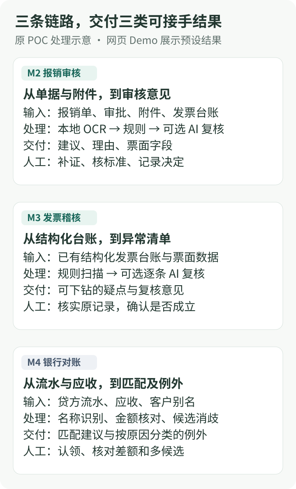

## 先把输入与交付物放在一起看

报销审核（M2）从一张待审单出发，发票稽核（M3）从整张结构化台账出发，银行对账（M4）需要同时拿到流水与应收。输入不同，能交给财务的结果也不同。

_图 1：原 POC 的业务处理示意。每条链路都把人工接手点写进交付物；网页 Demo 使用预设结果呈现这些交互。_

## M2 报销审核：证据齐了，规则才有判据

**输入**是一张待审单、费用明细、审批记录、附件和发票台账。系统先下载附件，用本地 OCR 提取票面字段，再把字段交给 11 类规则。可选模型给第二意见；图模式下，分歧或存疑单还可以进入受控调查。

**输出**包括建议通过（APPROVE）、建议驳回（REJECT）或存疑复核（FLAG），以及违规码、理由和可用票面字段。回写的是审核意见，ERP 单据审批状态保留给人操作。

一项关键处理是发票代码与号码索引。同一张票出现在两张报销单上，索引键相同；结合台账中的使用次数，重复发票规则就有了判据。

证据不足时，人工要接手的事项应当具体：附件下载失败需要补附件，OCR 失败需要核票面，城市标准缺失需要确认适用标准。在[10 元交通费案例](/projects/finance-review-agent/boundaries)中，金额已经核对过，缺口仍然是城市标准。

[体验 M2](/projects/finance-review-agent/demo/#/m2)：选择六张样例单并点击“模拟批量审核”，会得到四条建议驳回、两条存疑。这个分布是固定样例的预期结果。

## M3 发票稽核：把全量疑点变成可下钻清单

**输入**是已经结构化的发票台账与票面数据，这条处理链本身不再执行 OCR。数据质量和规则覆盖仍会影响结果。

**处理**是全量扫描重复票、抬头、税号、税率、连号和供应商档案六类问题。扫描结果保存为一份带版本号的结果文件（artifact），新版本保留旧版本，方便回看当时那批疑点。

**输出**是可以下钻的异常清单。AI 可以逐条复核，也可以分批全量巡检；后者只产生疑似清单。逐条复核的三个取值分别是：

| AI 意见                 | 财务怎样使用                 |
| ----------------------- | ---------------------------- |
| 确认疑点（CONFIRM）     | 对照原记录继续核实           |
| 仍有疑问（DOUBT）       | 补充材料或人工判断           |
| 疑似误报（FALSE_ALARM） | 检查规则是否在该条记录上误报 |

这些取值表达对疑点的看法，不承担票据放行。难点是维护全量规则、异常分类和原始记录之间的对应关系，让人能从一条疑点找到需要核实的材料。

[体验 M3](/projects/finance-review-agent/demo/#/m3)：运行模拟扫描，再进入异常详情查看预设 AI 意见。

## M4 银行对账：匹配要唯一，例外要说清原因

**输入**是银行流水 CSV 和处于未清、逾期状态的应收。系统先处理编码、表头、金额与重复流水号，再通过客户全称、别名和归一化名称查找候选应收。

**处理**按金额分四档：精确匹配、容差匹配、满足证据条件的唯一部分付款、一笔多票组合。部分付款除了候选唯一，还要求 ERP 返回累计付款等历史字段；不能仅凭“这个客户只有一张应收”就认领。

组合搜索为候选数、组合数和耗时设置预算。多候选、无法识别付款人、金额不符、流水号重复或超预算，都需要进入例外处理。

**输出**是匹配建议与按原因分类的未匹配清单（unidentified）。财务从原因分类中接手认领或核对，匹配结果本身不执行 ERP 核销。

[体验 M4](/projects/finance-review-agent/demo/#/m4)：三笔样例流水中，一笔借方不纳入回款匹配，两笔贷方得到一笔匹配、一笔待认领，所以显示 50%。Demo 展示的是这组固定结果；原 POC 的部分付款和多票组合机制需要在后端数据上验证。

## 三种难度，对应三种人工任务

| 链路 | 主要难点                 | 人工接手时要回答               |
| ---- | ------------------------ | ------------------------------ |
| M2   | 附件、票面与标准是否齐全 | 还缺哪项证据，适用哪条标准？   |
| M3   | 全量规则覆盖和异常可追溯 | 疑点是否成立，是否需要补证？   |
| M4   | 候选歧义和金额组合       | 这笔回款对应哪笔或哪几笔应收？ |

把人工要解决的问题说清楚，是三条链路共同的交付要求。权限分工见[机器判得清，人才敢放行](/projects/finance-review-agent/boundaries)，结果留存和评测见[审核结果如何留痕与验证](/projects/finance-review-agent/engineering)。
